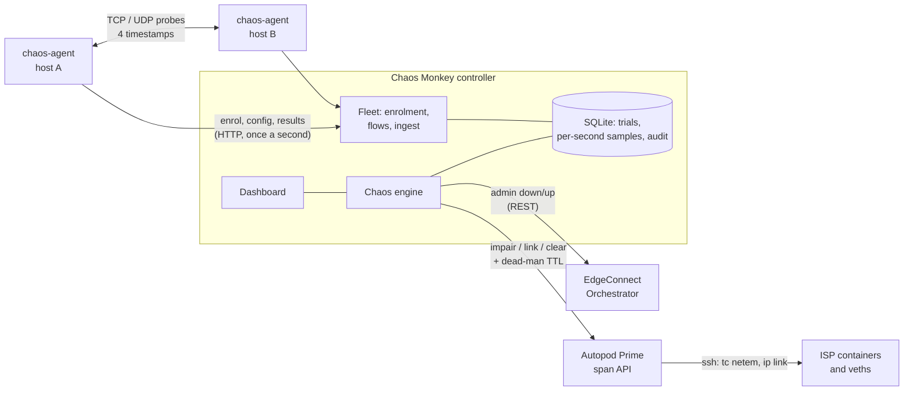

# ChaosLab

**Chaos Monkey, plus endpoints that measure what the chaos did.**

ChaosLab breaks one thing at a time in an SD-WAN lab (a WAN interface, a VRRP master, or a span of the
autopod ISP fabric), holds it, puts it back, and records what real host-to-host traffic saw before,
during and after: loss per direction, delay, jitter, and the length of every interruption to within one
packet interval.

It is three pieces:

| Piece | What it is | Where it runs |
|---|---|---|
| **Chaos Monkey** (controller) | Dashboard, chaos engine, history. Python standard library only: no `pip install`. | One host in the lab |
| **chaos-agent** (endpoint) | Sends and answers TCP and UDP test traffic, measures it, reports. One static binary, no runtime. | Every test host, Linux or Windows |
| **Span API** (in autopod Prime) | Impair or down any span of an autopod lab, either direction, with a dead-man timer. | Prime (separate change in the autopod repo) |

> [!CAUTION]
> Outside `--demo` this tool **breaks networks on purpose**: it admin-downs interfaces on real EdgeConnect
> appliances through Orchestrator and impairs or downs links in an autopod fabric. It is built for closed
> labs. The dashboard is plain HTTP and open by default, and it stores lab credentials. Do not run it
> anywhere a dropped link matters, and do not expose it beyond the lab. Provided as is, without warranty.
> Not an HPE product.

## Quick start

```bash
./chaos-monkey --demo      # simulated lab and endpoints: explore everything, touch nothing
./chaos-monkey             # live
```

The controller needs Python 3.9 or newer and nothing else. It prints its URLs and the two install
commands. Open the dashboard: the **Get started** card walks through the rest.

1. **Add endpoints.** On each test host, paste one line (the dashboard shows it with the right address
   and token):

   ```bash
   curl -fsSL 'http://<controller>:1666/install.sh?token=<join-token>' | sudo sh      # Linux
   wget -qO- 'http://<controller>:1666/install.sh?token=<join-token>' | sudo sh       # Linux, no curl
   ```
   ```powershell
   irm 'http://<controller>:1666/install.ps1?token=<join-token>' | iex               # Windows, elevated
   ```
2. **Create a flow** (Flows): point to point, point to multipoint, or full mesh; TCP or UDP; size, rate,
   DSCP and port of your choosing.
3. **Connect something to break** (Settings): an Orchestrator, an Autopod lab, or both.
4. **Discover**, trim the scope (Targets), and **Start run** (Overview).

### Getting it into a closed lab

The agent is written in Go, so *building* it needs a Go toolchain once. *Running* nothing needs one.
On any connected machine:

```bash
make bundle        # -> chaoslab-<version>.tar.gz: controller + agents for linux/amd64, linux/arm64, windows/amd64
```

Carry that one file in, unpack it, run `./chaos-monkey`. From a git checkout instead:
`python3 -m chaoslab build-agents` (the dashboard tells you if the builds are missing).

## How it fits together



Agents always dial out to the controller; nothing connects in to them except test traffic from other
agents. They keep measuring while the controller is unreachable (the normal case when the control
channel rides the fabric being broken), queue their per-second results (40,000 records: about eleven
hours for one leg, proportionally less for more), and upload when it is back. After 15 minutes without the controller they stop *sending* and keep answering.

### The credential, as asked: issued by Chaos Monkey, not signed

The controller generates a **join token** (for example `cm-zj3a-krf4-8ah6`) and embeds it in the install
commands. An agent trades it for its own opaque key at enrolment. Neither is signed, expiring or
one-time: they are random values the controller looks up. No TLS, no certificates. *Issue a new token*
on the Endpoints page invalidates old install commands; enrolled agents keep working.

## What is measured, and how far to trust it

Every probe carries four timestamps (sender out, reflector in, reflector out, sender in), and both ends
report to the controller for the same sender-clock second.

| Metric | How | Trust |
|---|---|---|
| **Round-trip time** | `(t4 − t1) − (t3 − t2)`: reflector dwell removed. Per second: min, mean, max, p50, p95, p99. | Exact. Each difference is taken on one host's clock. |
| **Loss, forward and return** | The sender counts what it sent and what came back; the reflector counts what arrived. `forward = sent − arrived`, `return = arrived − answered`. | Exact, and visible **while** an outage is in progress, because the reflector reports seconds in which nothing arrived. |
| **Interruption length** | A run of consecutive unanswered probes, from the send time of the first lost to the send time of the first answered. | Accurate to one packet interval (20 ms at 50 pps). |
| **Jitter per direction** | Mean absolute change in one-way transit time between consecutive probes. | Exact: the clock offset cancels in the difference. |
| **One-way delay** | RTT split using a clock offset estimated from the lowest-RTT exchanges, held for five minutes. | **Estimate.** Assumes the *baseline* path is symmetric. A delay added to one direction after a clean baseline shows in that direction; a path that was always asymmetric is split evenly. |
| **Late, duplicate, reordered** | By sequence number, at both ends. | Exact. |
| **TCP** | Paced messages over one connection, each echoed. "Loss" means *not delivered within the timeout*; reconnects are counted. On Linux the kernel's retransmit count and smoothed RTT are read from `TCP_INFO`. | App-level delivery is exact. Retransmits are Linux only. |

**Verified here** (`make test-agent`, against an in-process relay with known behaviour): every 10th
packet dropped forward and every 20th on return reads 9.99% / 5.00%; a +30 ms forward-only delay reads
30.5 ms forward and 0.02 ms return; a 730 ms blackhole reads 734 ms; a TCP outage is counted with its
reconnect.

**Timestamps.** Linux: kernel receive stamps (`SO_TIMESTAMPNS`) at both ends, user-space send stamps.
Windows: user space only, from `GetSystemTimePreciseAsFileTime`. The dashboard says per leg which each
end used. `chaos-agent selftest` prints the clock's smallest step and a loopback measurement on any host.

**Limits.** IPv4 only. Rates up to 50,000 packets per second per leg and packets up to 9,000 bytes are
accepted; on loopback on a 4-core Linux VM one leg held 50,000 pps for four seconds with every probe
answered, which says the agent keeps up, not what a real NIC and path will carry. DSCP is set with
`IP_TOS`, which Windows ignores without a QoS policy: the dashboard flags legs whose marking the OS did
not confirm.

## Breaking things

### One trial

```
precheck → baseline → inject → [VRRP failover] → hold → restore → verify → settle → verdict
```

`baseline` and `settle` exist for the measurements. A trial **recovers** when the driver confirms the
target is healthy again; separately it records, per flow leg, loss before/during/after by direction, the
RTT shift, every interruption, and how long after the inject traffic was first hit.

### Sources of faults

| Source | Targets | Fault |
|---|---|---|
| **EdgeConnect Orchestrator** | Every WAN-labelled interface; every VRRP instance that is currently master | Admin down, then up. VRRP adds failover detection and stabilisation checks. Ported unchanged in behaviour from SD-WAN Chaos Monkey. |
| **Autopod Prime, span API** | Every span of the lab: EC-V ↔ ISP-A/B, ISP uplinks, ISP cross-connect | Link down; or netem loss, delay, jitter, rate, in the direction toward the site, away from it, or both. Chosen at random from the menu you tick. |
| **Autopod Prime, older** | Only the sites Prime's allowlist permits (hubs) | Impairment toward the site only. No link down, no dead-man. The dashboard says when it is in this mode. |

The span API is a separate change in the autopod repo (`docs/SPAN-CHAOS-API.md` there). Prime needs
either an admin/eng login or a service token minted with the chaos grant:
`scripts/mint-service-token.py chaoslab-lab1 --scope lab1 --chaos`.

### Safety model

| Control | Behaviour |
|---|---|
| Discovery | Separate and read-only. |
| Scope | Per-target toggles, enforced by the controller, changeable only while idle. |
| Live runs | Need an explicit acknowledgement naming the scope and the systems; the controller refuses without it. |
| One at a time | Exactly one fault is held at any moment. |
| Stop | Ends the hold and restores. Ctrl-C and SIGTERM restore before exiting. |
| Failed restore | Retried immediately, reported as `RESTORE FAILED`, retried again when the run ends, and available as **Restore everything now**. |
| Dead-man | With the span API, Prime itself clears a span when its timer runs out, so a dead controller cannot leave the fabric impaired. Orchestrator has no equivalent: a `kill -9` mid-hold leaves an interface down. Check the audit trail. |
| Audit | Every state-changing call and every verdict, with result, kept in SQLite and exportable. |

## Configuration

```
./chaos-monkey [--host 0.0.0.0] [--port 1666] [--data DIR] [--demo] [--keep-days 14] [--no-browser] [--log-file F]
```

| Variable | Purpose |
|---|---|
| `CHAOSLAB_PASSWORD` | Require a password for the dashboard. Unset: open to anyone who can reach the port. |
| `CHAOSLAB_DATA` | Data directory (history, settings, credentials). Default `./data`. |
| `CHAOSLAB_ORCH_URL`, `CHAOSLAB_ORCH_TOKEN`, `CHAOSLAB_ORCH_VERIFY_TLS=0` | Orchestrator connection, instead of the Settings form. |
| `CHAOSLAB_PRIME_URL`, `CHAOSLAB_PRIME_LAB`, `CHAOSLAB_PRIME_USER`, `CHAOSLAB_PRIME_PASSWORD` or `CHAOSLAB_PRIME_TOKEN` | Autopod Prime connection. |

Connections saved from the Settings form live in the data directory's SQLite file, mode 0600. They are
never sent back to a browser. Use the environment variables if you would rather they were not stored.

## What has and has not been verified

Verified in this repository's tests, on Linux, without a lab:

- The agent's measurement maths against ground truth (above), UDP and TCP.
- Two real agent processes enrolling with a real controller and reporting loss-free loopback flows from
  both ends.
- The chaos engine end to end against the simulated lab: scope, stop-restores, failed-restore handling.
- The Orchestrator driver against an HTTP stand-in for the documented endpoints.
- The Autopod driver against an HTTP stand-in for the span API contract and for an older Prime.
- The install scripts parse (`sh -n`); bad tokens and hostile `Host` headers are refused.

**Not verified, because no such system was available:**

- **Anything on Windows.** The agent cross-compiles and vets for Windows; it has not been executed
  there. The PowerShell installer (scheduled task as LocalService, firewall rule) has not been run.
  Start with `chaos-agent.exe selftest` on one host.
- **systemd installation.** The Linux installer's systemd unit (`DynamicUser`, `StateDirectory`) has not
  been run; the no-systemd path's script has only been syntax-checked.
- **A live Orchestrator.** Same position as SD-WAN Chaos Monkey: the stand-in proves the logic, only a
  real Orchestrator proves the API contract. User/password authentication is carried over as HTTP basic
  and is unconfirmed; use an API key.
- **A live autopod lab.** The span API's node commands have never run against real nodes. See the
  "unverified" section of autopod `docs/SPAN-CHAOS-API.md`, in particular whether sudo on the nodes
  permits `tc` on host veths, and the blast radius of uplink and cross-connect spans (they carry OSPF
  and RADIUS).

## Where the ideas came from

| From | Carried over | Left behind |
|---|---|---|
| **netvitals** | One program at both ends; forward/return loss isolation; register-before-send; port-symmetric, self-describing framing; flow profiles; incompressible padding | Hand-matched ports with no control channel; RTT/2 as latency; RTT-based jitter; user-space-only stamps; the Tk/desktop UI, VXLAN mode, scoring (MOS/PQI) |
| **buffmon** | Four timestamps with dwell removed; kernel receive stamps; per-direction delay variation; one-second send-time buckets; absolute-schedule pacing that never bursts; idempotent uploads | STAMP wire compatibility, HMAC, ClickHouse, capacity trains and speed tests |
| **carnary** | The convergence-event model and the "how long was traffic down" framing | Window-threshold outage timing; unsynchronised one-way delay shown as RTT |
| **perf** | Fault-window bracketing; "no data" is never reported as loss | SSH-driven orchestration, scraping iperf3 output |
| **chaos_monkey** | The engine's WAN and VRRP logic, the audit trail, scope, stop-means-restore, the simulator, and the dashboard's visual language | Per-run auth key, loopback-only connection form, Flask/Socket.IO |
| **autopod / autopod_driver** | The ISP-container model, netem field validation, Prime's auth | The per-site allowlist, for chaos-capable credentials only |

## Layout

```
chaos-monkey            launcher
chaoslab/               controller (Python, stdlib only)
  __main__.py           entry point, build-agents
  server.py             HTTP: dashboard API, agent channel, downloads, install scripts
  fleet.py              endpoints, flows, ingest, derived numbers
  engine.py             trials and runs
  drivers/              orchestrator.py, autopod.py, sim.py
  installers.py         install.sh / install.ps1 templates
  store.py, rest.py     SQLite, HTTP client
  web/                  dashboard (no build step, no CDN)
agent/                  chaos-agent (Go, stdlib only); wire.go documents the packet format
tests/                  controller tests; agent tests live beside the agent
```

```bash
make test      # Go: measurement against ground truth. Python: fleet, engine, drivers, server, real agents.
make lint
```

The JetBrains Mono font is under the SIL Open Font License (`chaoslab/web/fonts/JetBrainsMono-OFL.txt`).
